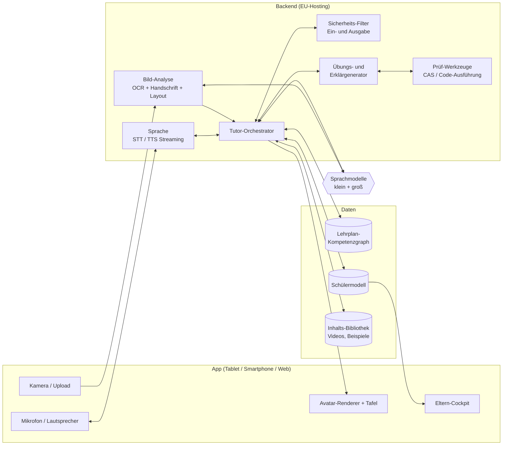

# KI-Tutor – Konzept & Machbarkeitsstudie

**Arbeitstitel:** KI-Tutor · **Stand:** 25.10.2026 · **Version:** 0.4 (Diskussionsgrundlage; Lernbegleitung über das Schuljahr und Mehrsprachigkeit ergänzt)

---

## 0. Management Summary

**Die Idee:** Eine KI-Nachhilfe-Plattform für Schüler:innen, die sich am *tatsächlichen* Unterricht orientiert. Die Kinder fotografieren Hefteinträge, Arbeitsblätter, Hausaufgaben und Schulbuchseiten. Daraus erkennt die KI, was gerade im Unterricht dran ist. Sie gleicht das mit dem Lehrplan ab, stellt passende Übungen, kontrolliert Hausaufgaben, erklärt bei Fehlern nach und zeigt am Beispiel der Hobbys des Kindes, wofür man den Stoff im echten Leben braucht. Erklärt wird per Sprache, mit einer Figur (Avatar) und einer digitalen Tafel.

**Der Kern ist Nachhilfe, keine Lern-App:** Das Kind kommt aus der Schule, öffnet die App und fotografiert Hefteintrag und Hausaufgaben. Ab da **führt der Tutor**: Er wiederholt den Stoff, begleitet die Hausaufgaben, gibt Übungsaufgaben und schließt mit einem Minitest ab, wie eine Nachhilfelehrkraft. Das Kind muss keine Inhalte aus Katalogen auswählen und keinem vorgefertigten Strukturplan folgen. Der heutige Unterricht bestimmt das Thema (Kap. 2.0).

**ChatGPT löst den Einzelfall, die Plattform begleitet das Kind:** Eine einzelne Aufgabe kann auch eine Universal-KI erklären. Die Plattform dagegen ist darauf ausgelegt, den **Lernstand des Kindes zu erfassen und über das Schuljahr hinweg gezielt zu fördern**. Sie kennt Stundenplan und anstehende Tests, plant die Vorbereitung, kontrolliert Hausaufgaben und prüft regelmäßig, ob das Wissen sitzt.

**Option Mehrsprachigkeit:** Kinder, die im deutschsprachigen Unterricht kaum mitkommen, bekommen den Schulstoff in ihrer Herkunftssprache erklärt, als Brücke zum Deutschen (Kap. 2.10).

**Kurzfazit:**

| Frage | Einschätzung |
|---|---|
| Ist die Idee gut? | **Ja.** Es gibt den Bedarf (Nachhilfemarkt in DE grob 1–1,5 Mrd. € pro Jahr, ca. 1,1 Mio. Nachhilfeschüler:innen pro Jahr), der Nutzen ist klar, und Studien zeigen: *gut gemachte* KI-Tutoren bringen messbare Lernfortschritte. |
| Ist sie technisch machbar? | **Ja, zum Großteil schon heute.** Etwa 80 % der Vision lassen sich mit heute verfügbarer Technik bauen. Schwierig ist weniger die KI selbst als das, was drumherum nötig ist: Lehrplandaten, didaktische Qualität, Fehlerkontrolle, Datenschutz für Kinder und Kosten pro Nutzer. |
| Was geht (noch) nicht? | Eine „allwissende, fehlerfreie“ KI gibt es nicht. Fotorealistische Video-Avatare in Echtzeit sind für ein Endkunden-Abo heute zu teuer. KI-generierte Klassenzimmer-Videos in Echtzeit sind noch nicht praxistauglich. |
| Ist es ein Selbstläufer? | **Nein.** Der Markt ist voll: Knowunity, Cornelsen/Duden, Klett, simpleclub, StudySmarter, Khanmigo sowie die kostenlosen Lernmodi von ChatGPT, Gemini und Claude. Den Unterschied machen Fokus, didaktische Qualität, Vertrauen der Eltern und der Vertrieb. |
| Empfehlung | **Bauen, aber fokussiert:** Start mit **Mathematik Klasse 5–10** in **einem Bundesland**. Foto-Upload, Chat, Sprache und Klassenarbeits-Plan sind inzwischen Standard (siehe [Marktrecherche](marktrecherche-bestehende-ki-tutoren.md)). Der Unterschied ist die **geführte Nachhilfestunde zum heutigen Unterrichtsstoff** statt einer Lernplattform, auf der das Kind Inhalte aus Katalogen wählt und einem Strukturplan folgt. Dazu kommen das Gedächtnis über das Schuljahr und ein sprechender, figurbasierter Tutor, voraussichtlich mit Fokus auf **jüngere Kinder (ca. 8–13)**, die von ChatGPT & Co. weitgehend ausgeschlossen sind. Avatar als **gezeichnete Figur** (günstig, kindgerecht), kein fotorealistischer Mensch. Erst ein Prototyp mit 15–30 Test-Kindern, dann die Entscheidung über das große Budget. |

**Ampel nach Bausteinen** (Details in Kapitel 5):

| Baustein | Ampel |
|---|---|
| Fotos von Buch-/Heftseiten verstehen | 🟢 |
| Handschrift von Kindern, Mathe-Notation | 🟡 |
| Abgleich mit Lehrplan und Schulbuch | 🟡 (Datenaufwand) |
| Übungsaufgaben erzeugen | 🟢 (mit Prüfschritt) |
| Hausaufgaben kontrollieren, Fehler diagnostizieren | 🟢 Mathe mit Rechenprüfung · 🟡 Freitext · 🟡/🔴 Skizzen und Konstruktionen |
| Erklären, Praxisbezug, Hobbys einbauen | 🟢 |
| Sprachdialog | 🟢 |
| Gezeichneter Avatar mit Lippensynchronität | 🟢 |
| Fotorealistischer Live-Avatar | 🟡 (technisch möglich, wirtschaftlich schwierig) |
| KI-generiertes Klassenzimmer-Video live | 🔴 (heute nicht wirtschaftlich) |
| Anpassung an Lernstand und Tempo | 🟡 (machbar, braucht Daten und Feintuning) |
| Erklärungen in Herkunftssprachen | 🟢 große Sprachen · 🟡 kleinere Sprachen |
| „Allwissend und fehlerfrei“ | 🔴 (nicht erreichbar, Produkt muss mit Fehlern umgehen können) |

---

## 1. Zielbild: Ein Nachmittag mit dem KI-Tutor

> **Lena, 7. Klasse.** Hobbys: Reiten und Minecraft. Montag 15:30 Uhr.
>
> 1. Lena öffnet die App und fotografiert die Mathe-Hausaufgabe (Buch S. 84, Nr. 3–6) und den heutigen Hefteintrag zu „Prozentrechnung: Grundwert berechnen“.
> 2. Der Tutor (ein gezeichneter Fuchs namens „Fin“) erkennt das Thema, ordnet es in den Lehrplan ein und sagt: *„Ah, ihr seid bei den Grundwerten! Rechne erst mal selbst, dann schauen wir zusammen drüber.“*
> 3. Lena rechnet auf Papier und fotografiert ihre Lösung. Fin erkennt: Aufgabe 3 und 4 sind richtig, bei 5 hat sie Prozentwert und Grundwert vertauscht. Er verrät die Lösung **nicht**, sondern fragt: *„Was sind denn in der Aufgabe die 100 %?“*
> 4. Lena findet den Fehler selbst. Fin erklärt das Prinzip noch einmal an der Tafel und baut ein Beispiel aus ihrer Welt: *„Dein Pferdefutter ist im Angebot um 15 % reduziert und kostet jetzt 34 €. Was hat es vorher gekostet?“*
> 5. Vier weitere Übungen, die schwerer werden. Bei der dritten braucht Lena einen Tipp. Fin merkt sich: Lena verwechselt Grundwert und Prozentwert noch, wenn die Aufgabe als Text formuliert ist.
> 6. Fin weiß aus Lenas Eintrag, dass am Donnerstag die Klassenarbeit ist. Er schlägt für Dienstag und Mittwoch je 15 Minuten Wiederholung vor, auch mit älterem Stoff (Brüche), der in der Arbeit drankommen kann.
> 7. Lenas Eltern sehen am Abend im Eltern-Cockpit: 35 Minuten gelernt, Prozentrechnung fast sicher, Textaufgaben üben, Klassenarbeits-Plan steht.

Dieses Szenario lässt sich mit heutiger Technik vollständig bauen.

---

## 2. Kernprodukt und Funktionsumfang

### 2.0 Kernprodukt: Nachhilfe auf zwei Ebenen

**Universal-KI, Lern-App oder Nachhilfe?** Eine Universal-KI wie ChatGPT erklärt eine einzelne Aufgabe gut, kennt aber weder das Kind noch seinen Unterricht. Lern-Apps wie Knowunity sind eigenständige Lernplattformen: Das Kind wählt Inhalte aus Katalogen oder legt einen Lernplan an und folgt dann einem vorgefertigten Strukturplan. Hochladen ist möglich, aber das Kind muss selbst wissen, was es tun will. Unser Ansatz ist ein anderer:

| | Universal-KI (z. B. ChatGPT) | Lern-App / Lernplattform | Unser Ansatz: Nachhilfe |
|---|---|---|---|
| **Wer bestimmt das Thema?** | Das Kind fragt, was es gerade braucht | Das Kind, per Auswahl aus Katalogen oder Lernplan | Der heutige Unterricht: Was das Kind fotografiert, ist das Thema |
| **Wer führt?** | Das Kind fragt, die KI antwortet | Das Kind steuert, die App folgt einem vorgefertigten Strukturplan | Der Tutor führt Schritt für Schritt, wie eine Nachhilfelehrkraft |
| **Typischer Einstieg** | „Wie geht diese Aufgabe?“ | „Was willst du lernen?“ | „Zeig mir, was ihr heute gemacht habt.“ |
| **Hausaufgaben** | Lösung oder Lösungsweg | Einzelne Aufgabe scannen, Lösungsweg ansehen | Kind löst selbst, Tutor begleitet und kontrolliert |
| **Lernstand** | keiner, jedes Gespräch steht für sich | Fortschritt innerhalb der App-Inhalte | Lernstand über das Schuljahr, aus Unterricht, Hausaufgaben und Minitests |
| **Planung** | keine | Lernplan nach Eingabe | Stundenplan und Testtermine; Vorbereitung und Wiederholung plant der Tutor |
| **Für wen?** | Kinder (ab 13), die wissen, was sie fragen wollen | Kinder, die sich selbst organisieren können | gerade auch Kinder, die Struktur brauchen, also die typischen Nachhilfe-Kinder |

**Warum das wichtig ist:** Kinder, die Nachhilfe brauchen, scheitern oft nicht nur am Stoff. Sie wissen nicht, wo sie anfangen sollen, was sie wiederholen müssen und wann sie etwas wirklich können. Eine Lernplattform setzt genau diese Selbststeuerung voraus. Die Plattform nimmt sie dem Kind ab und baut sie nach und nach auf, auf zwei Ebenen:
- **Ebene 1, jeden Tag:** die geführte Nachhilfestunde zum heutigen Stoff.
- **Ebene 2, über das Schuljahr:** die Lernbegleitung, die den Lernstand erfasst, Tests vorbereitet und prüft, ob das Wissen sitzt.

#### Ebene 1: Die geführte Nachhilfestunde

**Ablauf einer Stunde** (ca. 20–40 Minuten):

| Phase | Was passiert | Dauer |
|---|---|---|
| 1. Ankommen und Erfassen | Das Kind fotografiert Hefteintrag, Arbeitsblatt oder Buchseite und die Hausaufgabe. Der Tutor erkennt das Thema, ordnet es in den Lehrplan ein und knüpft daran an: *„Ihr habt heute mit Prozentrechnung angefangen.“* | 2–3 Min. |
| 2. Aufwärmen | 2–3 kurze Fragen zu früheren Themen, die zur Wiederholung fällig sind | 2–3 Min. |
| 3. Kurz-Check | 2–3 Fragen zum neuen Thema: Was hat das Kind verstanden? Danach entscheidet der Tutor, ob er erklärt oder direkt zu den Hausaufgaben geht | 2–3 Min. |
| 4. Erklären und Wiederholen | Nur bei Bedarf. Die Erklärung knüpft am Hefteintrag an (Begriffe und Schreibweise der Lehrkraft), mit Tafel, Stimme und Praxisbeispiel. Lücken im Vorwissen werden geschlossen | 5–10 Min. |
| 5. Hausaufgaben begleiten | Das Kind löst selbst auf Papier. Der Tutor hilft in Stufen, kontrolliert per Foto und findet die Ursache von Fehlern | 5–15 Min. |
| 6. Üben | 3–6 ähnliche Aufgaben mit steigender Schwierigkeit und Hobbybezug, gezielt auf die heute erkannten Fehler | 5–10 Min. |
| 7. Minitest | 3–5 Aufgaben ohne Hilfe, mit kurzer Auswertung | 3–5 Min. |
| 8. Abschluss | Lob für die Anstrengung, Zusammenfassung in zwei Sätzen, Ausblick auf die nächste Wiederholung, Kurzbericht an die Eltern | 1–2 Min. |

**Der Tutor passt die Stunde an:**
- **Kind kann das Thema schon:** Erklären überspringen, direkt zu den Hausaufgaben, anspruchsvollere Übungen.
- **Kind hat wenig Zeit** („Ich muss gleich zum Training“): nur Hausaufgaben mit Begleitung. Übungen und Minitest kommen in der nächsten Stunde.
- **Kind scheitert wiederholt:** zurück zum Vorwissen (z. B. Brüche vor Prozentrechnung) und kleinere Schritte.
- **Heute keine Hausaufgaben:** Die Stunde läuft mit dem Hefteintrag, also Wiederholen, Üben und Minitest.
- **Nichts fotografiert:** Der Tutor fragt nach dem Thema oder schlägt eine fällige Wiederholung vor.

**Technische Folge:** Die Stunde wird von einer festen Ablaufsteuerung im Tutor-Orchestrator gelenkt (Kap. 4.1), nicht von einem freien Chat. Das Sprachmodell füllt die Phasen mit Inhalt, die Struktur gibt der Code vor. Das macht die Stunde verlässlich und messbar.

#### Ebene 2: Lernbegleitung über das Schuljahr

Diese Ebene unterscheidet die Plattform von einer Universal-KI. Sie läuft im Hintergrund jeder Stunde mit und ist für Kind und Eltern sichtbar. Minitest-Ergebnisse, Hausaufgaben und Fehler fließen ins Schülermodell (2.3). So baut sich der Lernstand automatisch aus dem echten Unterricht auf, ohne dass das Kind etwas aus Katalogen auswählen muss.

| Baustein | Was passiert |
|---|---|
| **Lernstand erfassen** | Zum Start ein kurzer, spielerischer Einstiegs-Check pro Fach (ca. 10 Minuten) mit den Kernkompetenzen der aktuellen und der vorherigen Klassenstufe. Danach wird der Lernstand mit jeder Stunde, jedem Minitest und jeder Hausaufgabe fortgeschrieben. |
| **Stundenplan** | Einmal eintragen oder fotografieren. Der Tutor weiß dann, welche Fächer heute dran waren, und fragt gezielt: *„Heute hattest du Mathe und Englisch. Was habt ihr gemacht?“* |
| **Tests und Klassenarbeiten** | Termine eintragen oder das Hausaufgabenheft fotografieren. Der Tutor plant rückwärts: Welche Themen kommen dran, was sitzt schon, was muss bis wann wiederholt werden? (Klassenarbeits-Trainer, 2.9) |
| **Wochenplan** | Aus Stundenplan, Hausaufgaben, Terminen und fälligen Wiederholungen entsteht ein Vorschlag für die Woche: welcher Tag, wie lange, welches Fach. |
| **Prüfen, ob das Wissen sitzt** | Minitest am Ende jeder Stunde, Wiederholungsfragen nach der Vergessenskurve, kurze Probearbeiten vor Tests. Ein Thema gilt erst als sicher, wenn das Kind es mehrmals mit zeitlichem Abstand selbstständig löst. |
| **Lücken von früher schließen** | Gehen Fehler auf fehlendes Vorwissen zurück (z. B. Bruchrechnung in Klasse 8), plant der Tutor kurze Nachhol-Einheiten ein, verteilt über mehrere Tage. |
| **Übergeordnet fördern** | Über den Stoff hinaus: Lernstrategien (Wie lerne ich Vokabeln? Wie gehe ich eine Textaufgabe an?), Selbstorganisation (Hausaufgaben planen, für Tests einteilen) sowie Lesen und Textverständnis als Grundlage aller Fächer. Ziel ist, dass das Kind den Tutor mit der Zeit weniger braucht. |
| **Eltern** | Wochenbericht: Was war dran, was sitzt, wo hakt es, welche Tests stehen an, wie sieht der Plan aus (2.8). |

Stundenplan und Testtermine einzutragen, kennen Kinder bereits aus Lern-Apps wie Knowunity, und das funktioniert dort gut. Wir übernehmen es, verbinden es aber mit der geführten Stunde und dem Lernstand. Der Plan entsteht dann aus dem echten Unterricht und dem, was das Kind tatsächlich kann.

**Warum das schwer zu kopieren ist:** Eine Universal-KI beantwortet die Frage von heute gut. Sie kennt aber weder den Stundenplan noch die Klassenarbeit nächste Woche noch die Lücke aus Klasse 6. Dieses Wissen über das Kind und seinen Unterricht wächst mit jedem Schultag und ist der eigentliche Wert der Plattform.

Die folgenden Module 2.1–2.10 sind die Bausteine dieser beiden Ebenen.

### 2.1 Stoff-Erfassung (Foto-Input)
- **Was rein kann:** Buchseiten, Arbeitsblätter, Hefteinträge, Tafelbilder, Hausaufgaben, korrigierte Klassenarbeiten.
- **Was die KI daraus ableitet:** Fach, Thema, Lehrplanbezug, Aufgabennummern, verwendete Begriffe und Schreibweisen der Lehrkraft, Termine („Test am Do.“).
- **Onboarding-Trick:** Zum Schuljahresbeginn einmal das **Inhaltsverzeichnis** des Schulbuchs fotografieren. Damit kennt das System die Reihenfolge der Themen im Schuljahr, ohne den Buchinhalt selbst speichern zu müssen (siehe Urheberrecht, Kap. 7.3).
- **Datensparsamkeit:** Fotos werden nur kurz verarbeitet. Gespeichert werden die herausgezogenen Daten (Thema, Seite, Aufgaben, Ergebnis), nicht die Bilder. Namen auf Heften und Arbeitsblättern werden automatisch geschwärzt.

### 2.2 Lehrplan- und Kompetenzmodell
- Eine Wissenslandkarte (Kompetenzgraph) pro **Bundesland × Schulform × Klassenstufe × Fach**, aufgebaut aus öffentlichen Kerncurricula/Lehrplänen und den KMK-Bildungsstandards.
- Jede Kompetenz kennt ihre **Voraussetzungen**. Beispiel: Prozentrechnung braucht Bruchrechnung und Dreisatz. Wenn ein Kind an einer Stelle scheitert, kann der Tutor gezielt die eigentliche Lücke weiter unten finden.
- Ein Katalog **typischer Fehlvorstellungen** pro Thema, damit Fehler gezielt diagnostiziert werden können.
- **Aufwand:** Das ist der größte Datenblock des Projekts. Für Mathe 5–10 in einem Bundesland und einer Schulform ist er gut zu schaffen (wenige Wochen mit Lehrkraft plus KI-Unterstützung). Für 16 Bundesländer, alle Schulformen und alle Fächer ist er erheblich.

### 2.3 Schülermodell (das „Gedächtnis“ des Tutors)
- Kennt pro Kompetenz die **Beherrschung** (z. B. 0–100 %), mit Unsicherheit und Vergessenskurve.
- Kennt außerdem Lerntempo, bevorzugte Erklärweisen, Hobbys, Motivationslage (aus dem Dialog, **nicht** per Kamera, siehe Kap. 7.2), anstehende Termine und wiederkehrende Fehler.
- **Bewusst nicht modelliert:** „Intelligenz“. Das Kind wird nicht etikettiert. Modelliert werden nur Wissensstand und Lernverhalten. Das ist pädagogisch richtig und auch datenschutzrechtlich sauberer.

### 2.4 Übungsgenerator
- Erzeugt Aufgaben passend zu Thema, Niveau, Begriffen aus dem Unterricht und Hobbys.
- Nutzt bewährte Lernprinzipien: **Abrufübungen**, **verteiltes Wiederholen** (Spaced Repetition), **Mischen von Aufgabentypen** (Interleaving), **steigende Schwierigkeit**, **Lösungsbeispiele, die schrittweise ausgeblendet werden**.
- **Jede Aufgabe wird vor der Ausgabe automatisch geprüft:** In Mathe/Physik/Chemie rechnet ein Computer-Algebra-System nach. Ein zweiter KI-Durchgang prüft Lösbarkeit, Eindeutigkeit und Altersgerechtigkeit.

### 2.5 Hausaufgaben-Check und Fehlerdiagnose
- Prüfung **nach** dem eigenen Lösungsversuch, nicht statt ihm.
- Rückmeldung auf drei Stufen: (1) „Aufgabe 5 stimmt noch nicht“ → (2) „Schau dir Schritt 2 an“ → (3) gezielter Hinweis. Die vollständige Lösung gibt es erst, wenn das Kind selbst nicht weiterkommt, und dann als erklärtes Beispiel mit einer neuen Übungsaufgabe dazu.
- Ziel ist kein „Hausaufgaben-Löser“. Das ist zugleich der wichtigste Unterschied zu ChatGPT & Co. und das stärkste Argument gegenüber Eltern und Lehrkräften.

### 2.6 Erklären, Praxisbezug, Hobbys
- Mehrere Erklärwege pro Thema (bildlich, formal, Geschichte, Alltagsbeispiel). Wenn ein Weg nicht ankommt, kommt der nächste.
- **„Wozu brauche ich das?“** als feste Funktion: kurze Praxisgeschichten (Prozentrechnung → Rabatte, Zinsen, Handyvertrag; Photosynthese → Landwirtschaft, Klima; Chemische Reaktionen → Kochen, Batterie im Handy).
- **Hobby-Personalisierung:** Aufgaben werden in die Welt des Kindes übersetzt (Fußball, Pferde, Minecraft, Musik, Mode). Für die Wirkung von interessenbezogenen Textaufgaben gibt es empirische Belege (Walkington 2013).
- Optional: eine Rahmengeschichte oder Spielwelt, in der Lernfortschritt etwas freischaltet. Belohnt wird Lernen, nicht reine Bildschirmzeit (keine Dark Patterns).

### 2.7 Sprache, Avatar, Tafel

| Variante | Beschreibung | Kosten pro Nutzer | Empfehlung |
|---|---|---|---|
| **A: Gezeichnete Figur** (Tier/Maskottchen, 2D/3D) | Wird auf dem Gerät gerendert, Lippenbewegung synchron zur Sprachausgabe, Mimik per Animation | praktisch 0 € laufend (einmalig Design und Animation) | ✅ **Standard.** Kindgerecht, kein „Uncanny Valley“, wird zur Marke |
| **B: Fotorealistischer Lehrer** (Live-Video-Avatar über Anbieter-API) | Echtzeit-Videostream eines künstlichen Menschen | ca. 0,05–0,40 $ pro Minute, also bei 10 h/Monat **ca. 30–220 $ pro Kind und Monat** | ⚠️ höchstens als Premium-Funktion oder für kurze Sequenzen |
| **C: Digitale Tafel** | KI schreibt Schritt für Schritt Formeln, Skizzen, Diagramme und interaktive Graphen, synchron zur Stimme | gering | ✅ **Didaktisch am wertvollsten**, Kern der Erklärungen |
| **D: Generierte Erklärvideos** (Szenen, Experimente, „Klassenzimmer“) | Vorab erzeugte Kurzvideos zu häufigen Themen, einmal erzeugt und von allen genutzt | einmalig pro Video, laufend gering | ✅ als Bibliothek für Praxisbezüge, **nicht live** |

**Empfohlene Kombination:** Maskottchen (A) + digitale Tafel (C) + Video-Bibliothek (D). Ein Live-Avatar (B) kommt erst dann in Frage, wenn die Preise weiter fallen.

**Sprache:** Spracherkennung → Sprachmodell → Sprachausgabe in Echtzeit. Antwortzeit unter 1,5 s ist heute Standard. Kinderstimmen und Dialekte werden etwas schlechter erkannt, Rückfall auf Tippen oder Foto muss immer möglich sein.

### 2.8 Eltern-Cockpit
- Wochenbericht: Lernzeit, Themen, Fortschritt, Lücken, anstehende Arbeiten.
- Einstellungen: Zeitlimits, erlaubte Fächer, Datenschutz, Löschung.
- Bewusst **keine Chat-Protokolle als Standard**, damit das Kind dem Tutor gegenüber ehrlich bleibt. Ausnahme: Sicherheitsereignisse (Kap. 6).

### 2.9 Klassenarbeits-Trainer (Pflichtfunktion, kein Alleinstellungsmerkmal)
- Termin und Themen fotografieren oder eingeben. Daraus entsteht ein **Lernplan bis zur Arbeit**, mit einer Probearbeit unter Zeitdruck, Auswertung und gezielter Nacharbeit.
- Das ist der Moment, in dem Eltern zahlen, und ein klares Nutzenversprechen. Knowunity bietet Lernpläne bis zum Prüfungstermin und KI-bewertete Probeklausuren aber bereits an (siehe [Marktrecherche](marktrecherche-bestehende-ki-tutoren.md)). Die Funktion muss also da sein, unterscheidet uns aber nicht.

### 2.10 Mehrsprachige Nachhilfe: Schulstoff in der Herkunftssprache

**Das Problem:** Viele Kinder kommen im Unterricht nicht mit, weil sie ihn sprachlich nicht verstehen, und nicht, weil sie den Stoff nicht könnten. Rund **29 %** der Schüler:innen an allgemeinbildenden Schulen haben eine Einwanderungsgeschichte (2023), in NRW sind es im Schuljahr 2025/26 **44,6 %**. Schätzungsweise 18 % der Kinder und Jugendlichen sprechen zu Hause neben Deutsch mindestens eine weitere Sprache. Dazu kommen rund **227.000 ukrainische Schüler:innen** (Mitte 2025). Die Eltern können oft auch nicht helfen, weil sie selbst wenig Deutsch sprechen.

**Die Idee:** Der Tutor erklärt den deutschen Schulstoff in der Herkunftssprache des Kindes, aber als **Brücke zum Deutschen**, nicht als Ersatz. Unterricht, Tests und Klassenarbeiten bleiben auf Deutsch, das Kind muss also die deutschen Fachbegriffe und Aufgabentexte beherrschen. Das Prinzip entspricht dem sprachsensiblen Fachunterricht: Inhalt in der eigenen Sprache verstehen, Fachsprache auf Deutsch lernen.

| Stufe | So arbeitet der Tutor |
|---|---|
| **1. Einstieg** | Erklärung in der Herkunftssprache. Deutsche Fachbegriffe werden hervorgehoben und in einem zweisprachigen Glossar gesammelt („Zähler“, „Nenner“, „kürzen“). |
| **2. Brücke** | Gemischte Erklärung. Aufgaben kommen auf Deutsch, eine Übersetzung gibt es auf Tipp. Bei Textaufgaben hilft der Tutor zuerst, den deutschen Text zu verstehen, und erst dann beim Rechnen. |
| **3. Deutsch** | Unterricht auf Deutsch, die Herkunftssprache nur noch bei Bedarf. |

Der Tutor wechselt die Stufe von selbst, sobald das Kind sicherer wird, und misst dafür auch den Fortschritt im fachlichen Deutsch.

**Beispiel:** Amir, 6. Klasse, seit einem Jahr in Deutschland, spricht Arabisch. Er fotografiert den Hefteintrag zur Bruchrechnung. Fin erklärt auf Arabisch, schreibt an der Tafel „Zähler“ und „Nenner“ dazu und lässt Amir die Begriffe nachsprechen. Die Übungsaufgaben kommen auf Deutsch, die Übersetzung gibt es auf Tipp. Amirs Eltern bekommen den Wochenbericht auf Arabisch.

**Machbarkeit:**
- 🟢 **Große Sprachen** (Ukrainisch, Russisch, Arabisch, Türkisch, Polnisch, Persisch): Heutige Sprachmodelle erklären darin gut. Spracherkennung und Sprachausgabe sind verfügbar.
- 🟡 **Kleinere Sprachen** (z. B. Dari, Paschtu, Tigrinya, Kurmandschi, Somali): Text, Spracherkennung und Stimme sind schwächer und müssen vor dem Einsatz mit Muttersprachler:innen geprüft werden. Gesprochene arabische Dialekte sind schwieriger als Hocharabisch.
- **Didaktische Feinheiten:** Rechenverfahren und Schreibweisen unterscheiden sich zwischen Ländern (z. B. schriftliche Division, Dezimalkomma). Der Tutor muss das deutsche Verfahren lehren und das bekannte trotzdem anerkennen. Für Arabisch und Persisch braucht die App Rechts-nach-links-Text mit eingebetteten Formeln.
- **Kosten:** pro Nutzer kaum höher, weil die Sprachmodelle ohnehin mehrsprachig sind. Der Aufwand liegt in der Qualitätssicherung je Sprache (geprüfte Glossare, Testfälle, Prüfung durch Muttersprachler:innen).

**Markt und Vertrieb:** In einer kurzen Recherche habe ich kein Angebot gefunden, das deutschen Schulstoff geführt in der Herkunftssprache vermittelt. ChatGPT kann es im Einzelfall, wenn das Kind auf Arabisch fragt, aber ohne Struktur und erst ab 13. Familien in dieser Lage können oft wenig zahlen. Der passende Kanal sind daher eher **Kommunen, Integrationsprogramme, Schulen mit hohem Anteil an Kindern mit wenig Deutschkenntnissen (z. B. Startchancen-Schulen) und Träger von Vorbereitungsklassen**. Die soziale Wirkung ist zugleich ein starkes Argument für Fördermittel.

**Risiken:**
- Das Kind bleibt in der Herkunftssprache stecken. Dagegen helfen das Stufenprinzip und die Messung des Fortschritts im Deutschen.
- Fachbegriffe werden falsch übersetzt. Dagegen helfen geprüfte Glossare.
- Beispiele passen kulturell nicht. Dagegen hilft eine Prüfung durch Muttersprachler:innen.

**Empfehlung:** Die Architektur von Anfang an mehrsprachig anlegen, das kostet wenig. In Phase 2 einen Pilot mit zwei Sprachen starten (z. B. Ukrainisch und Arabisch), gemeinsam mit einer Kommune oder einer Schule.

---

## 3. Didaktisches Konzept: was nachweislich wirkt

### 3.1 Was die Forschung sagt
- **Einzelbetreuung wirkt stark.** Bloom (1984) berichtete für Einzelunterricht von bis zu +2 Standardabweichungen. Spätere Übersichten finden realistischer ca. +0,8. Gut gebaute schrittweise Tutorsysteme kamen schon vor der LLM-Ära nahe heran (VanLehn 2011: ca. +0,76).
- **KI-Tutor mit eingebauter Didaktik:** In einem randomisierten Versuch in Harvard (Physik, 194 Studierende) haben Studierende mit einem didaktisch gestalteten KI-Tutor *mehr als doppelt so viel* gelernt wie in gutem Präsenzunterricht mit aktivem Lernen (Kestin et al., Scientific Reports 2025). Laut den Autoren lag das an der eingebauten Didaktik und nicht einfach an der Stärke des Modells.
- **Weltbank, Nigeria (2025):** Nach sechs Wochen KI-gestütztem Nachmittagsprogramm +0,31 Standardabweichungen. Einschränkung: Die Kinder arbeiteten unter Aufsicht, und der Effekt enthält auch die zusätzliche Lernzeit.
- **Warnung, Wharton/Türkei (Bastani et al., PNAS 2025, ca. 1.000 Schüler:innen):** Mit **ungeschütztem ChatGPT** waren die Übungsergebnisse +48 % besser, die **spätere Prüfung ohne KI aber 17 % schlechter** als bei der Kontrollgruppe. Die Kinder hatten die KI als Krücke benutzt. Mit dem **Tutor mit Schutzmechanismen** (Hinweise statt Lösungen) verschwand der negative Effekt.

**Konsequenz:** Wie gut der Tutor wirkt, hängt am **didaktischen Design**, nicht an der KI-Technik. Ein KI-Tutor, der einfach Antworten gibt, kann dem Lernen schaden. Ein Tutor, der zum eigenen Denken anleitet, kann viel bewirken.

### 3.2 Didaktische Leitregeln für das Produkt
1. **Erst selbst versuchen, dann Hilfe**, und die Hilfe kommt in Stufen.
2. **Kurze Erklärung, dann sofort selbst anwenden** (Erklären → Üben → Rückmeldung).
3. **Wiederholen nach Vergessenskurve**, Themen mischen.
4. **Ein Thema gilt erst als gekonnt, wenn das Kind es mehrmals selbstständig richtig löst**, nicht nach einmaligem Erfolg.
5. **Fehler sind Informationen:** Der Tutor sucht die Fehlvorstellung dahinter.
6. **Relevanz und Interesse:** Praxisbezug und Hobbys, aber dosiert. Die Geschichte darf nicht von der Mathematik ablenken.
7. **Eigenständigkeit fördern:** Lernzeiten vorschlagen, Lernstrategien vermitteln, auch mal Pausen empfehlen.
8. **An den Unterricht anschließen:** Begriffe, Schreibweisen und Lösungswege der eigenen Lehrkraft übernehmen, damit es keine Verwirrung gibt („Bei uns macht man das aber anders!“).
9. **Ermutigend, aber ehrlich.** Kein leeres Lob, Lob für Anstrengung und Strategie.

---

## 4. Technische Architektur

### 4.1 Kernkomponenten
- **Tutor-Orchestrator:** steuert die geführte Stunde (Phasen aus Kap. 2.0: Erfassen → Aufwärmen → Kurz-Check → Erklären → Hausaufgaben → Üben → Minitest → Abschluss) und ruft Werkzeuge auf. Die Didaktik steckt in Code und Regeln, nicht nur in einem Prompt. Das macht den Tutor berechenbar.
- **Modell-Aufteilung:** Ein **kleines, schnelles Modell** führt den laufenden Dialog (günstig, kurze Antwortzeit). Ein **großes Modell** übernimmt Bildanalyse, Fehlerdiagnose, schwierige Erklärungen und Qualitätsprüfung. Die Architektur sollte **anbieterunabhängig** sein (Claude, OpenAI, Gemini, Mistral als EU-Anbieter usw.), damit Preise und Qualität laufend optimiert werden können.
- **Prüf-Werkzeuge:** Computer-Algebra (z. B. SymPy) und Code-Ausführung prüfen Rechnungen und erzeugte Aufgaben. Das ist der wichtigste Hebel gegen KI-Fehler in MINT-Fächern.
- **Sicherheits-Filter:** prüft Ein- und Ausgaben auf Themenrelevanz, Altersgerechtigkeit, Gefährdungsanzeichen (Kap. 6) und Prompt-Manipulation.
- **Bewertungssuite (Evals):** Hunderte bis Tausende Testfälle (echte Aufgabenfotos, typische Fehler, kritische Dialoge). Jede Änderung an Prompts oder Modellen wird automatisch dagegen getestet. **Das ist Kern-IP und Qualitätsgarantie.**

### 4.2 Tech-Stack (Vorschlag)
- App: Flutter oder React Native (iOS, Android, Tablets) plus Web.
- Backend: TypeScript oder Python, Postgres (inkl. Graph-Strukturen für den Lehrplan), Objektspeicher nur für Kurzzeit-Uploads.
- Avatar: Rive, Live2D oder Three.js/Unity mit Visem-basierter Lippensynchronität aus der Sprachausgabe.
- Tafel: KaTeX/MathJax, SVG-Animationen, JSXGraph oder GeoGebra-artige interaktive Graphen.
- Hosting: EU-Rechenzentrum. KI-Modelle über EU-Regionen der Cloud-Anbieter oder mit vertraglich zugesicherter EU-Verarbeitung und ohne Training auf Nutzerdaten.

---

## 5. Machbarkeit im Detail

| Baustein | Stand der Technik (Okt. 2026) | Ampel | Bemerkung |
|---|---|---|---|
| Gedruckte Buch- und Arbeitsblattseiten lesen | Sehr gut | 🟢 | Auch schräge Handyfotos, Tabellen, Formeln |
| Kinderhandschrift | Gut, nicht perfekt | 🟡 | Bei Unsicherheit nachfragen („Ist das eine 4 oder eine 9?“) |
| Geometrie-Skizzen, Konstruktionen, Diagramme bewerten | Mittel | 🟡/🔴 | Am Anfang bewusst ausklammern oder nur qualitativ bewerten |
| Thema und Lehrplanbezug erkennen | Gut | 🟢 | Mit Kompetenzgraph als Gerüst |
| Lehrplandaten für ganz DE | Aufwendig | 🟡 | Beginnen mit einem Bundesland und einer Schulform |
| Übungsaufgaben generieren | Sehr gut | 🟢 | Mit automatischer Prüfung |
| Mathe-Lösungen korrigieren | Sehr gut mit CAS | 🟢 | Ohne Prüfwerkzeug Restfehler im Prozentbereich |
| Freitext bewerten (Deutsch, Geschichte, Bio-Erklärungen) | Gut | 🟡 | Feedback ja, Noten-ähnliche Bewertung vorsichtig |
| Fremdsprachen (Vokabeln, Grammatik, Aussprache) | Gut bis sehr gut | 🟢 | Aussprachetraining per Sprache möglich |
| Schulstoff in der Herkunftssprache erklären | Gut bei großen Sprachen, schwächer bei kleinen | 🟢/🟡 | Glossare und Prüfung durch Muttersprachler:innen je Sprache (Kap. 2.10) |
| Erklärungen, Praxisbezug, Hobbys | Sehr gut | 🟢 | Stärke heutiger Sprachmodelle |
| Sprachdialog in Echtzeit, Deutsch | Gut | 🟢 | Kinderstimmen etwas schwieriger |
| Gezeichneter Avatar mit Lippensynchronität | Ausgereift | 🟢 | Einmaliger Design-Aufwand |
| Fotorealistischer Live-Avatar | Verfügbar | 🟡 | Kosten pro Minute das Problem |
| KI-Video in Echtzeit (Szenen, Klassenzimmer) | Experimentell | 🔴 | Vorab generierte Bibliothek stattdessen |
| Anpassung an Lernstand | Machbar | 🟡 | Braucht Feintuning mit echten Nutzungsdaten |
| Fehlerfreiheit | Nicht erreichbar | 🔴 | Fehler minimieren, erkennen und transparent machen |

**Gesamturteil Technik:** Machbar. Kein Baustein des Kernprodukts braucht Forschung, alles ist Ingenieursarbeit. Das Risiko liegt in **Qualitätssicherung und Integration**, nicht in fehlenden Fähigkeiten.

---

## 6. Grenzen und ehrliche Einschränkungen

1. **Nicht allwissend, nicht fehlerfrei.** Sprachmodelle machen gelegentlich Fehler, und zwar selbstbewusst. Bei einem Kind ist das besonders heikel, weil es den Fehler nicht erkennt. Gegenmaßnahmen: Prüfwerkzeuge, Zweitprüfung, Evals, ein Knopf „Das kommt mir falsch vor“ und kuratierte Inhalte für Kernthemen.
2. **Kein Ersatz für Lehrkraft und Eltern.** Motivation, Beziehung, Struktur und soziale Einbindung kann eine App nur zum Teil leisten. Gerade die Kinder, die Nachhilfe am nötigsten hätten, nutzen Apps oft am wenigsten selbstständig.
3. **Der Abgleich mit dem Unterricht hängt an der Mitarbeit des Kindes.** Wenn das Kind keine Fotos macht, weiß der Tutor nichts. Deshalb muss das Hochladen schnell gehen und sich lohnen (sofortiger Nutzen, kleine Belohnungen). Ersatzweise orientiert sich der Tutor am Lehrplan und an der üblichen Reihenfolge der Themen.
4. **Schummel-Risiko.** Jede Lern-KI kann als Lösungsmaschine missbraucht werden. Didaktische Schutzmechanismen reduzieren das, verhindern es aber nicht ganz. Kinder, die schummeln wollen, finden ChatGPT.
5. **Emotionale Bindung an eine Figur.** Ein freundlicher Avatar, der immer Zeit hat, kann für einsame Kinder zum Ersatz-Freund werden. Der Tutor muss als Lernbegleiter angelegt sein, nicht als Freund. Dazu gehören Zeitlimits, keine Gespräche über Beziehungen und Gefühle jenseits des Lernkontexts, und bei Problemen der Hinweis auf echte Ansprechpartner.
6. **Schutz bei Gefährdung.** Wenn ein Kind Hinweise auf Mobbing, Gewalt, Selbstverletzung o. Ä. äußert, braucht es ein klares Verfahren: ruhig reagieren, auf Hilfe hinweisen (z. B. Nummer gegen Kummer 116 111), je nach Konzept die Eltern informieren. Das muss mit Fachleuten erarbeitet werden.
7. **Lernstand und „Intelligenz“.** Die Anpassung an das Kind ist sinnvoll, ein IQ-artiges Profil nicht: pädagogisch fragwürdig, rechtlich heikel, und bei Eltern schnell ein Vertrauensproblem.
8. **Wirksamkeit muss bewiesen werden.** Ob das Produkt wirklich die Noten verbessert, zeigt erst eine eigene Pilotstudie. Ohne Nachweis bleibt es eine Behauptung, wie bei allen Wettbewerbern.

---

## 7. Recht und Regulierung

> Hinweis: Das ist eine fachliche Ersteinschätzung, **keine Rechtsberatung**. Vor dem Marktstart ist eine Prüfung durch eine auf IT-, Datenschutz- und Urheberrecht spezialisierte Kanzlei nötig.

### 7.1 Datenschutz (DSGVO)
- **Einwilligung der Eltern** ist in Deutschland bei Kindern unter 16 Jahren nötig (Art. 8 DSGVO), und das System muss sie nachprüfbar einholen.
- **Datenschutz-Folgenabschätzung (DSFA)** ist bei Profilbildung über Kinder praktisch Pflicht.
- **Datensparsamkeit:** Fotos nur kurz verarbeiten, Namen schwärzen, Sprachaufnahmen nicht speichern, klare Löschfristen.
- **KI-Anbieter:** Auftragsverarbeitungsverträge, EU-Verarbeitung, **kein Training auf Kinderdaten**, möglichst Zero-Data-Retention-Optionen.
- **Chance:** „Made in Germany, DSGVO-konform, kein Training mit Kinderdaten“ ist ein echtes Verkaufsargument gegenüber US-Anbietern.

### 7.2 EU AI Act
- **Transparenz (Art. 50):** Es muss klar erkennbar sein, dass man mit einer KI spricht. Ein Avatar darf **keinen echten Menschen nachahmen** (z. B. eine echte Lehrkraft).
- **Verbot der Emotionserkennung in Bildungseinrichtungen (Art. 5):** KI-gestützte Emotionserkennung per Kamera oder anderen biometrischen Daten ist in Bildungseinrichtungen verboten. Für eine private Heim-App ist das umstritten, bei Nutzung über Schulen gilt es sicher. **Empfehlung: grundsätzlich keine Emotionserkennung per Kamera.** Die Lernsituation wird aus dem Dialog und dem Antwortverhalten abgeleitet (Text ist vom Verbot nicht erfasst).
- **Hochrisiko (Anhang III Nr. 3):** KI-Systeme, die „Lernergebnisse bewerten, auch wenn diese zur Steuerung des Lernprozesses verwendet werden“, sind **in Bildungseinrichtungen** Hochrisiko-Systeme. Durch den AI-Omnibus (VO (EU) 2026/1744) gelten diese Pflichten **ab 2. Dezember 2027**.
  - **Privatkunden-Modell (Eltern kaufen die App):** fällt nach dem Wortlaut voraussichtlich nicht darunter, das ist aber noch nicht gerichtlich geklärt.
  - **Vertrieb an Schulen:** bedeutet sehr wahrscheinlich **Hochrisiko** mit Risikomanagement, technischer Dokumentation, Datenqualität, menschlicher Aufsicht und Konformitätsbewertung. Das ist ein großer, aber planbarer Aufwand.
  - **Empfehlung:** Mit dem Privatkunden-Modell starten, die Architektur aber von Anfang an „Hochrisiko-fähig“ bauen (Protokollierung, Dokumentation, Evals). Dann ist der spätere Schulvertrieb möglich, ohne neu bauen zu müssen.

### 7.3 Urheberrecht (Schulbücher)
- **Das Kind fotografiert sein Buch, um damit zu lernen:** Das ist für den Einzelfall vertretbar, aber nicht völlig risikofrei (Privatkopie § 53 UrhG, vorübergehende Verarbeitung § 44a UrhG). Das System sollte die Seiten **nur kurz verarbeiten**, nur Metadaten speichern (Thema, Seite, Aufgabennummer) und die Inhalte **nicht an andere Nutzer weitergeben**.
- **Problematisch** ist eine zentrale Schulbuch-Datenbank, die aus Nutzer-Uploads aufgebaut wird. Das wäre ohne Lizenz sehr wahrscheinlich unzulässig.
- **Strategische Chance:** Partnerschaften mit Verlagen (Inhaltsverzeichnisse, Aufgabenstrukturen, Lösungen). Allerdings bauen Cornelsen und Klett inzwischen eigene KI-Tutoren und sind damit gleichzeitig Wettbewerber. Kleinere Verlage oder Lernmaterial-Anbieter könnten offener sein.

### 7.4 Jugendschutz und Sonstiges
- Jugendschutzrecht (JuSchG/JMStV) und die Regeln der App-Stores für Kinder-Apps prüfen (Altersfreigabe, Werbung, In-App-Käufe).
- **Keine Werbung, keine manipulativen Kaufanreize gegenüber Kindern.** Gekauft wird über die Eltern.
- AGB, Haftungsbegrenzung für fachliche Fehler, Barrierefreiheit (BFSG).

---

## 8. Kosten pro Nutzer und Preismodell

### 8.1 Annahmen
- **Intensiv-Nutzer:** 30 Min. pro Tag an 20 Tagen = **10 Stunden pro Monat**. Durchschnittliche Nutzer liegen erfahrungsgemäß deutlich darunter (3–5 h).
- Etwa 40 Dialogschritte pro Stunde, 60 Foto-Analysen pro Monat.
- KI-Preise beispielhaft nach Anthropic-Listenpreisen (Okt. 2026, pro 1 Mio. Tokens): kleines Modell *Claude Haiku 5.5* 0,10 $ Eingabe / 0,50 $ Ausgabe; mittleres Modell *Claude Sonnet 5.5* 2 $ / 10 $; großes Modell *Claude Opus 5.5* 4 $ / 20 $. Wiederverwendete Kontexte (Prompt-Caching) sind deutlich günstiger. Andere Anbieter liegen in ähnlichen Größenordnungen.

### 8.2 Laufende Kosten pro Intensiv-Nutzer und Monat (Schätzung)

| Kostenblock | Annahme | ca. Kosten / Monat |
|---|---|---|
| Dialog (kleines Modell, ~70 %) + anspruchsvolle Schritte (mittleres Modell, ~30 %) | 400 Dialogschritte | 1,5–3 € |
| Foto-Analyse und Korrektur (mittleres/großes Modell) | 60 Fotos | 1,5–3 € |
| Aufgaben erzeugen und prüfen | inkl. Zweitprüfung | 0,5–1,5 € |
| Spracherkennung (Streaming) | ca. 4 h Kinderstimme | 1–2 € |
| Sprachausgabe | ca. 200.000 Zeichen | 1–10 € (je nach Stimmqualität und Anbieter) |
| Gezeichneter Avatar (auf dem Gerät) | | ~0 € |
| Hosting, Speicher, Monitoring | | 0,5–1 € |
| **Summe ohne Live-Video-Avatar** | | **ca. 6–20 € (Intensiv-Nutzer)**, **ca. 2–8 € (Durchschnitt)** |
| *Zusatz: fotorealistischer Live-Avatar* | 4–10 h Videostream | ***+30 bis +200 €*** |

**Erkenntnisse:**
- Ein Abo um **15–25 € pro Monat** ist wirtschaftlich darstellbar, vor allem, weil die KI-Preise pro Leistung derzeit jedes Jahr deutlich sinken.
- **Fotorealistische Live-Avatare würden das Geschäftsmodell sprengen.** Das Maskottchen ist nicht nur kindgerechter, sondern auch die wirtschaftlich richtige Wahl.
- Größter Kostenhebel: das kleine Modell für den Dialog und das große nur für Diagnose und Prüfung (muss mit Evals abgesichert werden).

### 8.3 Preis-Benchmarks
- Private Einzelnachhilfe: grob 20–40 € pro Stunde, bei 2× pro Woche **ca. 160–320 € pro Monat**.
- Nachhilfe-Institute: ähnlich oder teurer, mit Vertragsbindung.
- Digitale Angebote: Khanmigo (Khan Academy, gemeinnützig) ca. 4 $ pro Monat. Duden Learnattack mit KI-Tutor „Kim“ laut älterer Angabe knapp 30 € pro Monat. Knowunity, simpleclub und StudySmarter mit Freemium und Abo.
- **Positionierung:** „Nachhilfe-Qualität zum Preis eines Streaming-Abos“, z. B. 19,99 € pro Monat, Familien-Tarif, kostenloser Einstieg mit begrenzter Nutzung.

### 8.4 Weitere Vertriebswege
- **Nachhilfe-Institute** als B2B-Kunden (KI-Tutor für die Zeit zwischen den Präsenzstunden).
- **Arbeitgeber-Benefit** („Lernhilfe für Mitarbeiterkinder“), naheliegend auch für die eigenen Unternehmen.
- **Schulen und Kommunen**, z. B. über das Startchancen-Programm. Dafür ist die Hochrisiko-Compliance nach AI Act Voraussetzung (Kap. 7.2).
- **Kommunen und Integrationsprogramme** für die mehrsprachige Nachhilfe (Kap. 2.10), finanziert über Förderprogramme statt über das Familienbudget.

---

## 9. Markt und Wettbewerb

| Anbieter | Was sie machen | Stärke | Lücke / Angriffspunkt |
|---|---|---|---|
| **Knowunity** (Berlin) | Lern-App mit KI-Begleiter: 24/7-Chat mit Sprachmodus, Foto-Scan jeder Aufgabe, Upload eigener PDFs/Fotos/Notizen, Lernplan bis zur Prüfung nach Lehrplan, KI-bewertete Probeklausuren. Nach eigenen Angaben 30 Mio.+ Schüler:innen, Series B 27 Mio. € (2025) | Reichweite, Funktionsumfang, Kern kostenlos | **Der direkte Maßstab.** Eigener Test (Okt. 2026): eigenständige Lernplattform, auf der man Inhalte aus Katalogen wählt und einem vorgefertigten Strukturplan folgt; Hochladen ist möglich. **Keine geführte Nachhilfestunde, die vom heutigen Unterricht ausgeht.** Keine sprechende Figur bekannt |
| **Cornelsen / Duden Learnattack** | KI-Tutor „Kim“ (auch per WhatsApp), Übernahme des KI-Startups ezri (2025) | Verlagsinhalte, Marke | Verlagslogik, eigene Bücher im Fokus |
| **Klett** (x Studyly) | KI-LernCoach Mathe mit Analyse einzelner Rechenschritte (didacta 2026) | Didaktische Qualität, Lehrwerksbindung | Vor allem an eigene Lehrwerke gebunden |
| **simpleclub, StudySmarter, sofatutor** | Videos, Karteikarten, Lernpläne, zunehmend mit KI | Inhalte, Bekanntheit | Erklär-Content statt persönlicher Tutor |
| **Khanmigo** (USA) | Sokratischer KI-Tutor | Didaktik, Preis | Kein deutscher Lehrplan |
| **ChatGPT / Gemini / Claude** mit Lernmodi | Universal-KI mit Sprache, Foto-Upload und Lernmodus. Seit 18.08.2026 „ChatGPT for Teens“ mit Study Mode als Standard, Lernzeiten und Elternkontrollen | Kostenlos, sehr leistungsfähig, allgegenwärtig | Kein Lehrplanbezug, kein Schuljahres-Gedächtnis zum Unterricht. **Altersgrenzen:** ChatGPT ab 13, Claude ab 18, Gemini für Kinderkonten im EWR laut Drittquelle nicht verfügbar |
| **telli, fobizz** (über Schulen) | KI-Chat für Unterricht und Lernende, Landeslizenzen, EU-Hosting | Kostenlos für Schulen, datenschutzkonform | Auf den Unterricht ausgerichtet, kein persönlicher Nachmittags-Tutor |

**Die eigentliche Konkurrenz sind Knowunity und die kostenlosen Universal-KIs.** Jedes Kind ab 13 kann heute ein Aufgabenfoto in ChatGPT laden, und Knowunity deckt Foto, Chat, Sprache und Prüfungsplan bereits ab. Die Plattform muss also klar mehr bieten als „Foto rein, Erklärung raus“. Details: [Marktrecherche](marktrecherche-bestehende-ki-tutoren.md).

**Mögliche Alleinstellungsmerkmale (in dieser Reihenfolge, nach Marktrecherche und eigenem Test überarbeitet):**
1. **Geführte Nachhilfestunde zum heutigen Unterrichtsstoff (Kap. 2.0):** Das Kind fotografiert, der Tutor führt durch Wiederholung, Hausaufgaben, Übungen und Minitest. Es wählt nichts aus Katalogen aus. Das Versprechen an die Eltern: „Wie eine Nachhilfestunde, jeden Tag, zum Stoff von heute.“
2. **Lernbegleitung über das Schuljahr (Kap. 2.0, Ebene 2):** Der Tutor erfasst den Lernstand, kennt Stundenplan und Testtermine, plant die Vorbereitung, schließt Lücken aus früheren Klassen und prüft regelmäßig, ob das Wissen sitzt. Das kann eine Universal-KI, die nur den Einzelfall löst, nicht.
3. **Für jüngere Kinder gebaut (ca. 8–13):** sprechende Figur, Tafel, wenig Text, Einwilligung und Steuerung durch die Eltern. Diese Altersgruppe bedienen die Universal-KIs wegen ihrer Altersgrenzen kaum.
4. **Vertrauen:** deutsch, DSGVO-konform, kein Training auf Kinderdaten, Eltern-Cockpit.
5. **Erlebnis:** Maskottchen, Stimme, Tafel, Hobby-Bezug. Das ist der Grund, warum Kinder freiwillig wiederkommen.
6. **Mehrsprachig (Ausbaustufe):** deutscher Schulstoff in der Herkunftssprache als Brücke zum Deutschen (Kap. 2.10). Ein solches Angebot habe ich bisher nicht gefunden.

Der **Klassenarbeits-Trainer** bleibt eine wichtige Funktion, ist aber im Markt bereits vorhanden und daher kein Alleinstellungsmerkmal.

---

## 10. Risiken und Gegenmaßnahmen

| Risiko | Wahrsch. | Auswirkung | Gegenmaßnahme |
|---|---|---|---|
| Fachliche Fehler der KI | mittel | hoch (Vertrauen) | CAS-Prüfung, Zweitprüfung, Evals, Fehler-Meldeknopf, kuratierte Kerninhalte |
| Wird als „Hausaufgaben-Löser“ genutzt | hoch | mittel | Didaktische Schutzmechanismen, Eltern-Cockpit, Lernerfolg statt Lösungen messen |
| Geringe Nutzung / Kinder bleiben nicht dabei | hoch | hoch | Maskottchen, Spielwelt, Klassenarbeits-Trainer, Push-Erinnerungen in Absprache mit Eltern |
| Kundengewinnung teuer (vollgepackter Markt) | hoch | hoch | Klare Nische, Empfehlungsmarketing, B2B-Kanäle, Erfahrung aus dem eigenen D2C-E-Commerce nutzen |
| Kostenlose Big-Tech-Lernmodi werden besser | hoch | hoch | Auf Lehrplan, Schuljahres-Gedächtnis, Eltern und Vertrauen setzen, nicht auf reine KI-Leistung |
| Datenschutzvorfall mit Kinderdaten | gering | sehr hoch | Datensparsamkeit, EU-Hosting, Sicherheitsaudit, DSFA |
| Urheberrechtsstreit mit Verlagen | gering–mittel | mittel | Nur Kurzzeit-Verarbeitung, keine Inhaltsdatenbank, Lizenzpartnerschaften prüfen |
| Regulatorische Pflichten (AI Act) beim Schulvertrieb | sicher (bei B2B-Schule) | mittel | Erst Privatkunden, Architektur „Hochrisiko-fähig“ |
| KI-Kosten steigen statt fallen | gering | mittel | Anbieterunabhängige Architektur, kleines Modell für den Dialog |
| Kritischer Vorfall (z. B. unangemessene Antwort an ein Kind) | gering | sehr hoch | Mehrstufige Filter, Red-Teaming, Notfallprozess, klare Grenzen für die Figur |

---

## 11. Umsetzungsplan

### Phase 0: Prototyp und Machbarkeitsnachweis (6–8 Wochen)
- **Umfang:** Mathe, eine Klassenstufe (z. B. 7), ein Bundesland, eine Schulform. Eine vollständige geführte Stunde (Kap. 2.0): Foto → Thema erkennen → Kurz-Check → Erklären → Hausaufgabe begleiten → Üben → Minitest. Mit Text und Sprache, als einfache Web-App mit statischer Maskottchen-Grafik.
- **Test:** 15–30 Kinder, z. B. aus dem Umfeld der eigenen Mitarbeiter (20 Familien = idealer erster Testerkreis).
- **Messen:** Wie oft ist die KI fachlich falsch? Wie gut wird Handschrift erkannt? Kommen die Kinder freiwillig wieder? Was sagen die Eltern? Würden sie zahlen?
- **Team:** 1–2 Entwickler:innen + 1 Mathe-Lehrkraft (Teilzeit). **Budget grob 30–70 T€.**
- **Entscheidungspunkt:** weitermachen, anpassen oder stoppen.

### Phase 1: MVP / geschlossene Beta (4–6 Monate)
- Mathe 5–10, geführte Stunde, Schülermodell mit Einstiegs-Check, Stundenplan und Testtermine, Klassenarbeits-Trainer, animiertes Maskottchen, Tafel, Eltern-Cockpit, Einwilligungsprozess, DSFA. Architektur bereits mehrsprachig angelegt.
- 200–1.000 Beta-Familien, wenn möglich mit einer kleinen Wirksamkeitsstudie (Vor- und Nachtest).
- **Team:** Produktverantwortung, 2–3 Entwicklung (App, Backend, KI), 1 Didaktik, Design (extern), Recht/Datenschutz (extern). **Budget grob 250–450 T€.**

### Phase 2: Marktstart und Ausbau (6–12 Monate)
- Weitere Fächer (Englisch, Deutsch, Physik, Chemie, Biologie), weitere Bundesländer, Video-Bibliothek für Praxisbezüge, Spielwelt.
- Pilot mehrsprachige Nachhilfe mit zwei Sprachen (z. B. Ukrainisch und Arabisch), gemeinsam mit einer Kommune oder Schule (Kap. 2.10).
- Bezahl-Abo, Marketing, B2B-Pilot mit Nachhilfe-Instituten oder Arbeitgebern.
- **Budget** stark abhängig vom Marketing: grob 0,5–1,5 Mio. € zusätzlich.

### Phase 3: Skalierung
- Schulen und Kommunen (AI-Act-Compliance), Verlagspartnerschaften, Premium-Funktionen (z. B. Live-Avatar, sobald die Kosten passen), internationale Lehrpläne.

> Die Budgets sind grobe Richtwerte für eine Umsetzung mit festem Team in Deutschland. Mit KI-gestützter Softwareentwicklung und schlankem Team lassen sich vor allem Phase 0 und 1 deutlich günstiger und schneller umsetzen.

### Organisatorische Empfehlung
Das Vorhaben ist ein eigenständiges Software- und Verbraucher-Geschäft und unterscheidet sich grundlegend vom Sensor- und Elektronikgeschäft. Empfehlung: **eigene Gesellschaft bzw. eigenes Team** mit klarer Produktverantwortung. Didaktische Kompetenz (mindestens eine erfahrene Lehrkraft) gehört **von Tag 1** ins Kernteam, nicht als externe Beratung.

---

## 12. Gesamteinschätzung

**Die Idee ist gut, zeitgemäß und technisch weitgehend umsetzbar.** Es ist realistisch, dass KI-Tutoren in den nächsten Jahren für viele Familien die klassische Nachhilfe ergänzen oder ersetzen. Die Forschung zeigt, dass das Lernen wirklich verbessern kann, *wenn* der Tutor didaktisch klug gebaut ist.

**Die Hauptarbeit liegt nicht in der KI.** Sprachmodelle, Bildverstehen und Sprachausgabe sind eingekauft und werden jedes Jahr besser und billiger. Den Erfolg entscheiden:
1. **Didaktisches Design:** Hilfe zum Denken statt Antworten.
2. **Lehrplan- und Unterrichtsbezug:** der eigentliche Burggraben.
3. **Qualitätssicherung:** systematische Tests, Prüfwerkzeuge, Umgang mit Fehlern.
4. **Vertrauen:** Datenschutz, Kinderschutz, Transparenz gegenüber Eltern.
5. **Vertrieb:** In einem vollen Markt gewinnt, wer Familien günstig erreicht und dauerhaft hält.

**Was ich an der Vision anpassen würde:**
- Statt „allwissende KI“: **„geduldiger Lernbegleiter, der seine Grenzen kennt“**.
- Statt fotorealistischem Lehrer: **sympathische, gezeichnete Figur + digitale Tafel**. Das ist günstiger, kindgerechter und unterscheidbarer.
- Statt „Intelligenz erkennen“: **Wissensstand und Lerntempo modellieren**.
- Statt alle Fächer gleichzeitig: **Mathe zuerst**, weil es das größte Nachhilfefach ist und sich Lösungen dort maschinell prüfen lassen.

---

## 13. Nächste Schritte

1. **Fokus festlegen:** Bundesland, Schulform, Klassenstufen für den Start.
2. **Prototyp der geführten Nachhilfestunde** (Foto → Thema → Kurz-Check → Hausaufgabe begleiten → Üben → Minitest) mit 20–50 echten Aufgabenfotos als erste Testbasis.
3. **Testfamilien gewinnen** (z. B. Mitarbeiterkinder) und eine Mathe-Lehrkraft als Didaktik-Partner.
4. **Rechtliche Erstberatung** (DSGVO bei Kindern, AI Act, Urheberrecht Schulbücher).
5. **Name, Figur, Markenauftritt** skizzieren.
6. **Go/No-Go** nach Phase 0 anhand klarer Kriterien (z. B. fachliche Fehlerquote < 2 %, 60 % der Test-Kinder nutzen es in Woche 3 noch, Zahlungsbereitschaft der Eltern ≥ 15 €/Monat).

---

## Quellen (Auswahl)

**Wirksamkeit**
- Kestin et al. (2025): *AI tutoring outperforms in-class active learning*, Scientific Reports. Zusammenfassung: [iatrox.com](https://www.iatrox.com/blog/harvard-ai-tutor-trial-what-it-showed-question-banks)
- De Simone et al. / Weltbank (2025): *From Chalkboards to Chatbots: Evaluating the Impact of Generative AI on Learning Outcomes in Nigeria*: [openknowledge.worldbank.org](https://openknowledge.worldbank.org/entities/publication/15e1ff08-15ae-4f7a-b2a8-d146e6c113ee/full), [VoxDev](https://www.voxdev.org/topic/education/how-ai-tutors-improved-learning-nigeria)
- Bastani et al. (2025): *Generative AI without guardrails can harm learning: Evidence from high school mathematics*, PNAS 122(26): [SSRN](https://papers.ssrn.com/abstract=4895486), [Wharton Knowledge](https://knowledge.wharton.upenn.edu/article/without-guardrails-generative-ai-can-harm-education)
- VanLehn (2011): *The Relative Effectiveness of Human Tutoring, Intelligent Tutoring Systems, and Other Tutoring Systems*, Educational Psychologist 46(4).
- Walkington (2013): *Using adaptive learning technologies to personalize instruction to student interests*, Journal of Educational Psychology 105(4).
- Bloom (1984): *The 2 Sigma Problem*, Educational Researcher 13(6).

**Markt**
- Bertelsmann Stiftung, Ausgaben für Nachhilfe: [PDF](https://bertelsmann-stiftung.de/fileadmin/files/BSt/Publikationen/GrauePublikationen/GP_Ausgaben_fuer_Nachhilfe.pdf)
- news4teachers (2024) zur Studienkreis-/Forsa-Umfrage: [Link](https://www.news4teachers.de/2024/08/die-haelfte-der-eltern-sieht-nachhilfe-als-stuetze-des-bildungssystems-neun-von-zehn-fordern-gratis-nachhilfe-fuer-alle/)
- Schüler:innen mit Einwanderungsgeschichte (29 %, 2023): [t-online/dpa](https://www.t-online.de/nachrichten/deutschland/id_100481400/jeder-dritte-schueler-hat-einwanderungsgeschichte.html) · NRW 2025/26 (44,6 %): [news4teachers](https://www.news4teachers.de/2026/09/knapp-die-haelfte-der-schueler-in-nordrhein-westfalen-hat-eine-migrationsgeschichte/)
- Mehrsprachigkeit in Familien (ca. 18 %): [Mediendienst Integration / Robert Bosch Stiftung, Expertise 2025](https://www.bosch-stiftung.de/sites/default/files/publications/pdf/2025-05/Mediendienst_Expertise_Mehrsprachigkeit_2025.pdf)
- Ukrainische Schüler:innen (ca. 227.000, Q2 2025): [news4teachers](https://www.news4teachers.de/2025/07/227-000-zahl-ukrainischer-schueler-in-deutschen-schulen-auf-hoechststand/)
- Knowunity Series B: [tech.eu](https://tech.eu/2025/06/13/knowunity-raises-eur27m-to-bring-ai-tutor-to-1-billion-students/), [startbase](https://www.startbase.de/news/knowunity-mit-27-millionen-euro-series-b/)
- Cornelsen übernimmt ezri: [cio.de](https://www.cio.de/article/3807245/cornelsen-gruppe-ubernimmt-ki-startup-ezri.html)
- Klett didacta 2026 (KI-LernCoach): [bildungsmedien.de](https://bildungsmedien.de/images/inhalte/presse/pressemappe_didacta_2026/PM_didactaEKV.pdf)
- Khanmigo Preise: [toolradar](https://toolradar.com/tools/khanmigo/pricing)

**Recht**
- AI-Omnibus / Verschiebung Hochrisiko-Pflichten: [Lewis Silkin](https://www.lewissilkin.com/insights/2026/07/27/the-digital-omnibus-on-ai-enters-into-force-today-102nedo), [Addleshaw Goddard](https://www.addleshawgoddard.com/en/insights/insights-briefings/2026/technology/eu-ai-act-ai-omnibus-formally-adopted/)
- Anhang III Nr. 3(b), Lernergebnisse: [aiactblog.nl](https://www.aiactblog.nl/en/annex-iii/onderwijs-beroepsopleiding/learning-outcomes), [Jisc](https://regulatorydevelopments.jiscinvolve.org/wp/2022/12/13/eu-ai-act-scope-of-education/)
- Verbot der Emotionserkennung in Bildungseinrichtungen: [FPF](https://fpf.org/blog/red-lines-under-eu-ai-act-unpacking-the-prohibition-of-emotion-recognition-in-the-workplace-and-education-institutions/), [CMS](https://cms.law/en/gbr/legal-updates/eu-commission-issues-guidelines-on-prohibited-ai-practices-part-ii)
- TDM-Schranke § 44b UrhG, OLG Hamburg 2025: [beck-aktuell](https://www.beck-aktuell.de/heute-im-recht/rechtsprechung/olg-hh-5u10424-nutzung-foto-ki-training-2025-12-10)

**Technik und Kosten**
- KI-Modellpreise: Anthropic-Listenpreise, Stand Okt. 2026
- Avatar-Preise: [Forasoft](https://www.forasoft.com/blog/article/heygen-alternatives), [HeyGen](https://www.heygen.com/blog/best-real-time-ai-avatar-platforms), [usagepricing (Tavus)](https://usagepricing.com/blueprint/tavus)
- Sprache (STT/TTS): [AssemblyAI](https://assemblyai.com/blog/speech-to-text-api-pricing), [Apiframe](https://apiframe.ai/blog/best-text-to-speech-apis-2026)

*Preisangaben aus Drittquellen sind Richtwerte und vor Entscheidungen bei den Anbietern zu prüfen.*
